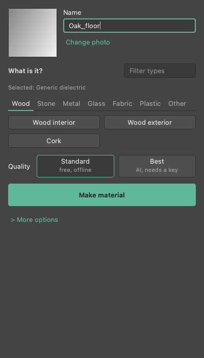
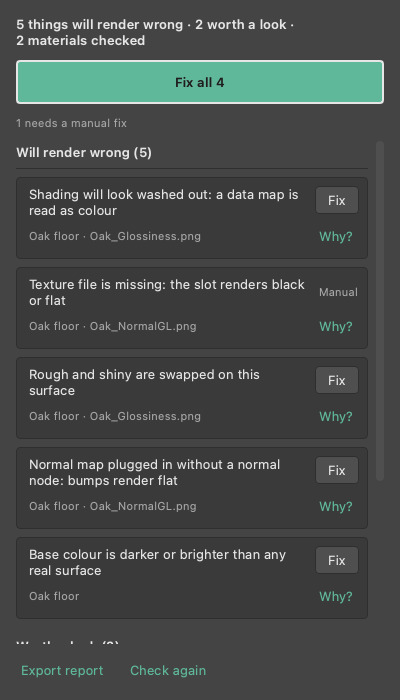

# MatForge v1 — reference image → render-ready V-Ray **or Corona** material

One click: reference image + name + material type + resolution (2K/4K/8K)
→ PBR maps derived, physically-correct VRayMtl or CoronaPhysicalMtl wired, dropped on a
Material Editor sphere, optionally assigned to selection.

## Compatibility — 3ds Max 2022 → 2027
- **In-Max code runs on Python 3.7** (Max 2022) through 3.13 (Max 2027) —
  vermin-verified, no 3.8+ syntax, no type annotations that would break on 3.7.
- **Map generation runs in a system Python** (auto-resolved: `py -3.12` → `py -3`
  → `python`, first one that has Pillow+numpy) — never Max's bundled Python, so
  the Max version doesn't matter. Requires a system Python 3 with `pip install
  Pillow numpy` (and `fal-client` for the Ultra engine).
- **V-Ray**: every property is written through defensive candidate lists, so
  name drift across V-Ray 5/6/7 logs a MISS instead of crashing. Metalness maps
  need V-Ray 5+ (all supported Max versions ship it). Confirmed `SMOKE_OK` on
  Max 2026 + V-Ray 7.30.
- **UI**: a native Qt dock (PySide6, or PySide2 on older Max). If PySide is missing the
  classic rollout opens instead and the Listener says so.
- `pymxs.undo` is used only if present (older builds fall back to a no-op).

## Install
MatForge runs from wherever its folder lives; nothing is tied to a user name or
drive. Needs 3ds Max 2022-2027 (V-Ray 7 and/or Corona) and a system Python 3
with `pip install -r requirements.txt` (Pillow + numpy) for map generation.

**Bundle route (recommended for other machines)**
1. On any box with Python 3: `python tools/build_matforge_bundle.py` →
   `dist/MatForge.bundle` (no keys, tests or notes are shipped; the build
   refuses if one slips in).
2. Copy `MatForge.bundle` to `%ProgramData%\Autodesk\ApplicationPlugins\`
   (or point `ADSK_APPLICATION_PLUGINS` at `dist\` to test) and restart Max.
   Its startup script registers the **MatForge** actions against the bundle's
   own `Contents\scripts` folder on every start.
3. Customize > Customize User Interface > Toolbars, category **MatForge**, drag
   **MatForge** onto a toolbar. (Max 2025+ dropped the classic menu API, so
   it's a toolbar button, not a menu.)

**Run-from-repo route (dev box)**
1. Clone/copy the repo anywhere.
2. Scripting > Run Script... > **`install_matforge.ms`** from that folder —
   registers the **MatForge** actions with that folder baked in and opens MatForge. Re-run it if you move the
   folder. Then add the toolbar button as in step 3 above.

`run_matforge.py` finds its folder from `__file__`, else the `MATFORGE_ROOT`
environment variable, else the `MatForgeRoot` global the installer / toolbar
actions set. Keys: `_keys.json` beside the plugin files if one exists
(run-from-repo), otherwise per-user `%APPDATA%\MatForge\_keys.json` (where the
Settings tab saves them on a bundle install). Both are git-ignored and never
bundled. On-box checks for this: `docs/VERIFY_INSTALL.md`.

## Use
Open **MatForge** from the toolbar. It docks on the right.
1. Drop a photo of the material on the dock (or press **Browse...**).
2. Pick what it is (Wood, Stone, Metal, Glass, Fabric, Plastic, Other). Generic is preselected.
3. Press **Make material**.

**Quality** has two choices. **Standard** is free and offline (10 to 60 seconds). **Best** uses
the fal AI backend and needs a fal key (about a minute). Add keys under the gear button
(**Settings**); the same sheet has an **Ask a question** field for help.

**More options** holds Renderer (Auto, V-Ray, Corona, Both), Metal (for metal types), Size
(2K, 4K, 8K), **Make it tile seamlessly**, **Put on selected objects** and **Open in Slate**.

When it finishes, the Done screen shows the material name, its slot per renderer, five map
thumbnails (Colour, Roughness, Normal, Height, Metalness), and notes. From there you can put it
on the selected objects, open it in Slate, or press **Make another**. **Cancel** stops a running job.

If PySide is missing the classic rollout opens and the Listener says so
(`[MatForge] Qt dock unavailable (...)`). You can also open it by hand with `forge_max.show_rollout()`.




## Plugin files
```
install_matforge.ms   run once (run-from-repo) -> MatForge toolbar actions
matforge_macros.ms    shared: registers the macros with a resolved folder baked in
packaging/MatForge.bundle  ApplicationPlugins template (tools/build_matforge_bundle.py)
run_matforge.py       opens the MatForge dock (classic rollout if Qt is missing)
maxplugin/forge_qt.py  the MatForge dock (PySide6/PySide2)
forgeui/              shared Qt kit used by MatForge and the Inspector
maxplugin/forge_max.py  UI backend: engine routing (Fast/Ultra) + classic rollout
```

## Physics layer (`matphys/`)
Pure Python (3.7 syntax, no dependencies), shared by MatForge and the Inspector so
there is one source of truth. It holds exact conductor Fresnel (F0 and a
Gulbrandsen edge tint), measured n,k for 13 metals, a glass table (IOR plus
absorption stored as transmittance at a reference thickness) and the albedo
bounds. Everything is sampled at three wavelengths, 650 / 550 / 450 nm (R/G/B);
D65-weighted projection is future work.
- **F0 / edge tint**: a named metal with no metalness map uses F0 as the base
  colour (albedo map kept at a 30 % blend) and the edge tint as the reflection
  (V-Ray) or edge colour (Corona).
- **Absorption**: converted per renderer from the same σ: V-Ray fog colour and
  multiplier, Corona absorption colour and distance.
- Swatches are written scene-linear (F0, edge tint, fog, absorption alike):
  3ds Max stores colour parameters linear, and gamma "Affect Color Selectors"
  / OCIO only changes what the picker displays. On-box check: see
  `docs/VERIFY_VRAY.md` (swatch row).

## Corona
- Same 35 classes as V-Ray, built as `CoronaPhysicalMtl` by `maxplugin/builder_corona.py`;
  a coloured gem or glass photo's body colour goes into the absorption colour,
  as it goes into V-Ray's fog.
- Named metals use Complex IOR (n,k) with a fallback to F0 base plus edge colour
  if the property is missing.
- Displacement lives in the material (no modifier); foliage uses translucency and
  opacity cutout with no wrapper material.
- Property names are UNVERIFIED against Corona 14/15: see `docs/VERIFY_CORONA.md`
  (not yet verified on-box; the headless smoke now runs a Corona loop too).

## What the wiring guarantees (per material class, from `core/recipes.py`)
- Fresnel ON, IOR from physics table (1.5 dielectrics, 1.52 glass, ...)
- Roughness mode ON, roughness map plugged directly (no gloss-invert errors)
- Data maps (roughness, normal, height, opacity) load **raw in every colour
  pipeline**: under 3ds Max 2024+ OCIO the gamma keyword is ignored and PNGs
  decode as sRGB, so they open in the config's data colour space instead
  (verified on Max 2026.2: gamma 1.0 read a 50 % grey as 0.216, raw read 0.502)
- Normal via VRayNormalMap; coat and sheen glossiness written as roughness
  (V-Ray 7 inverts them under Use roughness; refraction glossiness it does not)
- Glass: thin-walled with one pane's measured transmittance as the tint; solid
  glass, water and gems get fog in cm (colour = transmittance, depth =
  thickness), so absorption is right in any scene units; a strongly coloured
  photo (amethyst, bottle green) adds its body colour
- Marble and wax: V-Ray 7 SSS mode with measured scatter radii (Jensen 2001)
- Foliage: stochastic opacity + VRay2SidedMtl translucency, **never
  refraction**; a leaf shot on a plain backdrop is keyed into a cut-out
- Fabric sheen in the fibre's own colour, leather/lacquer coat, brushed-metal
  anisotropy, emissive that reads under any camera exposure
- AO map exported but not wired (V-Ray GI already occludes; baked AO
  double-darkens)
- Uniform materials (fabric, velvet, leather, carpet, paint, cork, rubber,
  plastics, sand, asphalt, metals, wax) get stochastic tiling when their maps
  tile and carry no pattern (the manifest records `seamless`, and `pattern`
  when the forge kept a stripe or check, which random offsets would break at
  every repeat): every map is a
  VRayBitmap driven by one shared VRayUVWRandomizer that offsets each texture
  repeat at random, seeded per object too so matching cushions differ, and
  blends it into its neighbours (offsets only, so normal maps stay right; data
  maps raw, colour maps sRGB primaries, whatever the render settings). Their
  displacement uses 3D mapping so the relief follows the same offsets. Wood,
  stone, tiles and marble keep plain tiling so planks, joints and veins line up

## How the maps are derived (`core/maps.py`, Standard quality)
- De-lighting fits a smooth polynomial to the photo's lighting and divides it
  out, so plank-to-plank and tile-to-tile tone survives
- Height is band-limited luminance with a per-class relief model: wood grain,
  joints, weave and pile are relief; marble veins, terrazzo chips and trowel
  clouds are colour only (polished stone, glass and chrome stay flat)
- Normals use periodic Scharr gradients scaled with resolution; upscaled
  photos are band-limited to their native detail
- Roughness comes from cavities plus tileable low-frequency variation, not
  from the colour pattern
- Tiling uses periodic + smooth decomposition (no mirrored ghost seams)
- Uniform materials also lose brightness drift wider than ~1/16 of the tile
  (leftover lighting), which tiled into a patchwork grid on a linen sofa. One
  achromatic gain, held to 0.8-1.25, keeps every colour; a photo whose
  tile-scale colour or tone varies like a pattern (stripes, checks, a print,
  a dip-dye) or steps in sharp edges lined up across the tile (a tone-on-tone
  stripe or check) is left alone, with a warning. Diagonal stripes are not
  recognised
- Laid tiles (zellige, terracotta) with a straight, regular grout grid are cut
  into whole tiles at the joint centres measured in each row and column, and
  re-laid at random in a grid that keeps the tile's shape, so the repeat ends
  on grout (a photo's border never does) and no lattice of identical tiles
  shows. The layout is found on the photo's 2K frame and seeded by the photo,
  so 2K look-dev and a 4K or 8K final lay the same tiles, with every cut
  re-centred on its joint at the output size. Tiles are turned only when no
  light direction shows across them (a lit or shadowed bevel, a glint,
  falloff, read out to the tile's edge), and the joints are sunk and matte in
  the height and roughness. A tile whose joint wanders across the straight
  cut along its own length would carry a sliver of its neighbour, so it is
  left out of the re-lay. Running bond, hex, a photo turned more than
  ~0.3 deg, a grid that is not regular and joints wandering off the cuts at
  all but a few tiles are left as shot. The manifest's `grid_tiles` gives the
  tiles per repeat

The realism lab in `tools/realism_lab/` renders every class on a modelled
room (sofa, tables, props) in V-Ray; `tools/apartment/` builds a whole
two-bedroom flat with every surface made by MatForge. Both write 16-bit PNGs
and dither them to 8 bits (`tools/render_post.py`): a denoised wall saved
straight to 8 bits bands into pink and green contours.

## Architecture
```
forge_fal.py          fal PATINA backend: image -> studio-grade PBR maps
                      (basecolor/normal/roughness/metalness/height, de-lit,
                      seamless, up to 4K) behind the SAME manifest contract.
                      Needs FAL_KEY. This is the v4 AI quality upgrade.
forge_cli.py          system Python (py -3.12): image -> maps (PIL/numpy)
core/maps.py          deterministic derivation: de-light, normal, roughness,
                      height, AO, seamless tiling, 2K/4K/8K
core/recipes.py       physics + wiring table (single source of truth)
maxplugin/builder.py  in-Max pymxs wiring, V-Ray (defensive property candidates)
maxplugin/builder_corona.py  CoronaPhysicalMtl wiring, parity with builder.py
maxplugin/corona_props.py    Corona property-name candidate lists (unverified)
matphys/              pure-Python physics: Fresnel, metal n,k, glass, albedo
docs/VERIFY_VRAY.md   V-Ray items to confirm on-box
docs/VERIFY_CORONA.md Corona items to confirm on-box (not yet verified)
maxplugin/forge_max.py  dialog UI
MAX_SMOKE.py          run inside Max -> SMOKE_OK + property-miss report
tests/mock_pymxs.py   fake pymxs runtime — exercises builder wiring off-Max
tests/                pytest checks (py -3.12 -m pytest tests)
```

## What is proven WITHOUT 3ds Max
`tests/test_builder_logic.py` drives `builder.py` through a mock `pymxs`
runtime, so the class-correct wiring contract is verified deterministically:
foliage becomes a VRay2SidedMtl that never refracts + clip opacity; glass gets
thin-walled refraction with near-white clamped fog; metals get metalness +
anisotropy; data maps load linear while albedo does not; the material lands on
the active editor slot; displacement is added only where the recipe calls for
it; and a missing V-Ray property logs a MISS instead of crashing. The one thing
this cannot verify is whether the real V-Ray 7 property *names* match — that is
exactly what `MAX_SMOKE.py` checks live.

Two map backends, same manifest contract (swap freely, Max side unchanged):
- `forge_cli.py` — deterministic heuristic (Materialize-class), no key, offline.
- `forge_fal.py` — **fal PATINA** AI backend (extract endpoint by default, see `docs/PATINA_ENDPOINT.md`) (studio-grade de-lit maps +
  per-pixel metalness, up to 4K). Set `FAL_KEY`, then:
  `py -3.12 forge_fal.py ref.jpg --name Oak --type wood_interior --upscale 2`.
  The builder auto-wires the metalness map (`texmap_metalness`) when present.

## Verify
- Core + wiring logic: `python3 -m pytest tests -q` and `cd inspector && python3 -m pytest -q` (see counts in CI)
- **Live V-Ray (no GUI):** `3dsmaxbatch.exe -log smoke_batch.log smoke_wrapper.ms`
  runs `HEADLESS_SMOKE.py` → writes `smoke_result.txt`. Builds all 35 classes
  against real V-Ray, reports any property-name misses. **Confirmed `SMOKE_OK`,
  0 misses on 3ds Max 2026 + V-Ray 7.30** (2026-07-22). Kill any interactive
  Max first so the batch can check out the license.
- In Max: run `MAX_SMOKE.py` → expect `SMOKE_OK` (or `SMOKE_OK_WITH_MISSES`
  listing V-Ray property names to add to the candidate lists)


---

## Material Inspector (`inspector/`) — Phase 1 of the v5 plan
Scans every VRayMtl / CoronaPhysicalMtl in a scene for physically wrong settings
(data maps loaded as sRGB, swapped gloss/roughness, normal maps in bump, impossible
albedo, glass without absorption, IOR out of range, seams, …) and fixes them with
undo. Shares MatForge's verified V-Ray property names and its `openBitMap(gamma=…)`
colour handling. Not yet run inside 3ds Max — start with
`inspector/docs/FIRST_WINDOWS_SESSION.md`. Tests: `cd inspector && python -m pytest -q`.
It also audits OpenPBR materials (class and property names unverified) and flags
AI-generator faults: baked lighting, inverted height polarity, upscaled maps, and an
aggregate "looks AI-generated" note, plus a named-metal-vs-F0 check.
Plan documents: `docs/plan/`.
