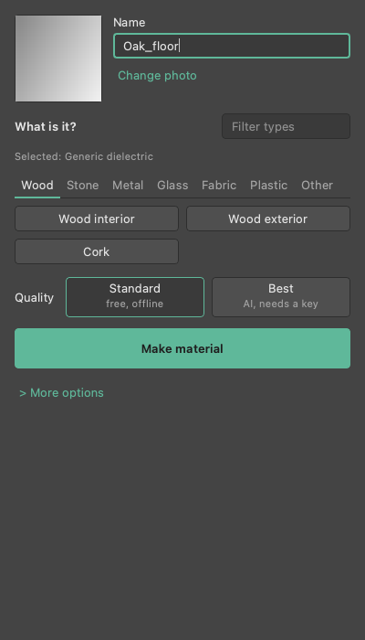
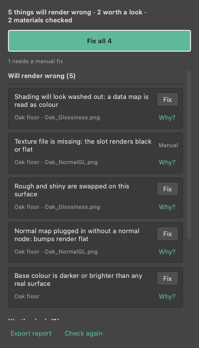

# MatForge v1 — reference image → render-ready V-Ray **or Corona** material

One click: reference image + name + material type + resolution (2K/4K/8K)
→ PBR maps derived, physically-correct VRayMtl or CoronaPhysicalMtl wired, dropped on a
Material Editor sphere, optionally assigned to selection.

## Compatibility — 3ds Max 2022 → 2027
- **In-Max code runs on Python 3.7** (Max 2022) through 3.13 (Max 2027) —
  vermin-verified, no 3.8+ syntax, no type annotations that would break on 3.7.
- **Map generation runs in a system Python** (auto-resolved: `py -3.12` → `py -3`
  → `python`, first one that has Pillow+numpy) — never Max's bundled Python, so
  the Max version doesn't matter. Requires a system Python 3 with `pip install
  Pillow numpy` (and `fal-client` for the Ultra engine).
- **V-Ray**: every property is written through defensive candidate lists, so
  name drift across V-Ray 5/6/7 logs a MISS instead of crashing. Metalness maps
  need V-Ray 5+ (all supported Max versions ship it). Confirmed `SMOKE_OK` on
  Max 2026 + V-Ray 7.30.
- **UI**: a native Qt dock (PySide6, or PySide2 on older Max). If PySide is missing the
  classic rollout opens instead and the Listener says so.
- `pymxs.undo` is used only if present (older builds fall back to a no-op).

## Install
MatForge runs from wherever its folder lives; nothing is tied to a user name or
drive. Needs 3ds Max 2022-2027 (V-Ray 7 and/or Corona) and a system Python 3
with `pip install -r requirements.txt` (Pillow + numpy) for map generation.

**Bundle route (recommended for other machines)**
1. On any box with Python 3: `python tools/build_matforge_bundle.py` →
   `dist/MatForge.bundle` (no keys, tests or notes are shipped; the build
   refuses if one slips in).
2. Copy `MatForge.bundle` to `%ProgramData%\Autodesk\ApplicationPlugins\`
   (or point `ADSK_APPLICATION_PLUGINS` at `dist\` to test) and restart Max.
   Its startup script registers the **MatForge** actions against the bundle's
   own `Contents\scripts` folder on every start.
3. Customize > Customize User Interface > Toolbars, category **MatForge**, drag
   **MatForge** onto a toolbar. (Max 2025+ dropped the classic menu API, so
   it's a toolbar button, not a menu.)

**Run-from-repo route (dev box)**
1. Clone/copy the repo anywhere.
2. Scripting > Run Script... > **`install_matforge.ms`** from that folder —
   registers the **MatForge** actions with that folder baked in and opens MatForge. Re-run it if you move the
   folder. Then add the toolbar button as in step 3 above.

`run_matforge.py` finds its folder from `__file__`, else the `MATFORGE_ROOT`
environment variable, else the `MatForgeRoot` global the installer / toolbar
actions set. Keys: `_keys.json` beside the plugin files if one exists
(run-from-repo), otherwise per-user `%APPDATA%\MatForge\_keys.json` (where the
Settings tab saves them on a bundle install). Both are git-ignored and never
bundled. On-box checks for this: `docs/VERIFY_INSTALL.md`.

## Use
Open **MatForge** from the toolbar. It docks on the right.
1. Drop a photo of the material on the dock (or press **Browse...**).
2. Pick what it is (Wood, Stone, Metal, Glass, Fabric, Plastic, Other). Generic is preselected.
3. Press **Make material**.

**Quality** has two choices. **Standard** is free and offline (10 to 60 seconds). **Best** uses
the fal AI backend and needs a fal key (about a minute). Add keys under the gear button
(**Settings**); the same sheet has an **Ask a question** field for help.

**More options** holds Renderer (Auto, V-Ray, Corona, Both), Metal (for metal types), Size
(2K, 4K, 8K), **Make it tile seamlessly**, **Put on selected objects** and **Open in Slate**.

When it finishes, the Done screen shows the material name, its slot per renderer, five map
thumbnails (Colour, Roughness, Normal, Height, Metalness), and notes. From there you can put it
on the selected objects, open it in Slate, or press **Make another**. **Cancel** stops a running job.

If PySide is missing the classic rollout opens and the Listener says so
(`[MatForge] Qt dock unavailable (...)`). You can also open it by hand with `forge_max.show_rollout()`.




## Plugin files
```
install_matforge.ms   run once (run-from-repo) -> MatForge toolbar actions
matforge_macros.ms    shared: registers the macros with a resolved folder baked in
packaging/MatForge.bundle  ApplicationPlugins template (tools/build_matforge_bundle.py)
run_matforge.py       opens the MatForge dock (classic rollout if Qt is missing)
maxplugin/forge_qt.py  the MatForge dock (PySide6/PySide2)
forgeui/              shared Qt kit used by MatForge and the Inspector
maxplugin/forge_max.py  UI backend: engine routing (Fast/Ultra) + classic rollout
```

## Physics layer (`matphys/`)
Pure Python (3.7 syntax, no dependencies), shared by MatForge and the Inspector so
there is one source of truth. It holds exact conductor Fresnel (F0 and a
Gulbrandsen edge tint), measured n,k for 13 metals, a glass table (IOR plus
absorption stored as transmittance at a reference thickness) and the albedo
bounds. Everything is sampled at three wavelengths, 650 / 550 / 450 nm (R/G/B);
D65-weighted projection is future work.
- **F0 / edge tint**: a named metal with no metalness map uses F0 as the base
  colour (albedo map kept at a 30 % blend) and the edge tint as the reflection
  (V-Ray) or edge colour (Corona).
- **Absorption**: converted per renderer from the same σ: V-Ray fog colour and
  multiplier, Corona absorption colour and distance.
- Swatches are written scene-linear (F0, edge tint, fog, absorption alike):
  3ds Max stores colour parameters linear, and gamma "Affect Color Selectors"
  / OCIO only changes what the picker displays. On-box check: see
  `docs/VERIFY_VRAY.md` (swatch row).

## Corona
- Same 35 classes as V-Ray, built as `CoronaPhysicalMtl` by `maxplugin/builder_corona.py`.
- Named metals use Complex IOR (n,k) with a fallback to F0 base plus edge colour
  if the property is missing.
- Displacement lives in the material (no modifier); foliage uses translucency and
  opacity cutout with no wrapper material.
- Property names are UNVERIFIED against Corona 14/15: see `docs/VERIFY_CORONA.md`
  (not yet verified on-box; the headless smoke now runs a Corona loop too).

## What the wiring guarantees (per material class, from `core/recipes.py`)
- Fresnel ON, IOR from physics table (1.5 dielectrics, 1.52 glass, ...)
- Roughness mode ON, roughness map plugged directly (no gloss-invert errors)
- Normal via VRayNormalMap at gamma 1.0; data maps loaded linear
- Glass: thin-walled, fog clamped near-white, affect-shadows ON
- Foliage: clip-mode opacity + VRay2SidedMtl translucency, **never refraction**
- Fabric sheen, leather/lacquer coat, marble translucency, brushed-metal
  anisotropy
- AO map exported but not wired (V-Ray GI already occludes; baked AO
  double-darkens)

## Architecture
```
forge_fal.py          fal PATINA backend: image -> studio-grade PBR maps
                      (basecolor/normal/roughness/metalness/height, de-lit,
                      seamless, up to 4K) behind the SAME manifest contract.
                      Needs FAL_KEY. This is the v4 AI quality upgrade.
forge_cli.py          system Python (py -3.12): image -> maps (PIL/numpy)
core/maps.py          deterministic derivation: de-light, normal, roughness,
                      height, AO, seamless tiling, 2K/4K/8K
core/recipes.py       physics + wiring table (single source of truth)
maxplugin/builder.py  in-Max pymxs wiring, V-Ray (defensive property candidates)
maxplugin/builder_corona.py  CoronaPhysicalMtl wiring, parity with builder.py
maxplugin/corona_props.py    Corona property-name candidate lists (unverified)
matphys/              pure-Python physics: Fresnel, metal n,k, glass, albedo
docs/VERIFY_VRAY.md   V-Ray items to confirm on-box
docs/VERIFY_CORONA.md Corona items to confirm on-box (not yet verified)
maxplugin/forge_max.py  dialog UI
MAX_SMOKE.py          run inside Max -> SMOKE_OK + property-miss report
tests/mock_pymxs.py   fake pymxs runtime — exercises builder wiring off-Max
tests/                pytest checks (py -3.12 -m pytest tests)
```

## What is proven WITHOUT 3ds Max
`tests/test_builder_logic.py` drives `builder.py` through a mock `pymxs`
runtime, so the class-correct wiring contract is verified deterministically:
foliage becomes a VRay2SidedMtl that never refracts + clip opacity; glass gets
thin-walled refraction with near-white clamped fog; metals get metalness +
anisotropy; data maps load linear while albedo does not; the material lands on
the active editor slot; displacement is added only where the recipe calls for
it; and a missing V-Ray property logs a MISS instead of crashing. The one thing
this cannot verify is whether the real V-Ray 7 property *names* match — that is
exactly what `MAX_SMOKE.py` checks live.

Two map backends, same manifest contract (swap freely, Max side unchanged):
- `forge_cli.py` — deterministic heuristic (Materialize-class), no key, offline.
- `forge_fal.py` — **fal PATINA** AI backend (extract endpoint by default, see `docs/PATINA_ENDPOINT.md`) (studio-grade de-lit maps +
  per-pixel metalness, up to 4K). Set `FAL_KEY`, then:
  `py -3.12 forge_fal.py ref.jpg --name Oak --type wood_interior --upscale 2`.
  The builder auto-wires the metalness map (`texmap_metalness`) when present.

## Verify
- Core + wiring logic: `python3 -m pytest tests -q` and `cd inspector && python3 -m pytest -q` (see counts in CI)
- **Live V-Ray (no GUI):** `3dsmaxbatch.exe -log smoke_batch.log smoke_wrapper.ms`
  runs `HEADLESS_SMOKE.py` → writes `smoke_result.txt`. Builds all 35 classes
  against real V-Ray, reports any property-name misses. **Confirmed `SMOKE_OK`,
  0 misses on 3ds Max 2026 + V-Ray 7.30** (2026-07-22). Kill any interactive
  Max first so the batch can check out the license.
- In Max: run `MAX_SMOKE.py` → expect `SMOKE_OK` (or `SMOKE_OK_WITH_MISSES`
  listing V-Ray property names to add to the candidate lists)


---

## Material Inspector (`inspector/`) — Phase 1 of the v5 plan
Scans every VRayMtl / CoronaPhysicalMtl in a scene for physically wrong settings
(data maps loaded as sRGB, swapped gloss/roughness, normal maps in bump, impossible
albedo, glass without absorption, IOR out of range, seams, …) and fixes them with
undo. Shares MatForge's verified V-Ray property names and its `openBitMap(gamma=…)`
colour handling. Not yet run inside 3ds Max — start with
`inspector/docs/FIRST_WINDOWS_SESSION.md`. Tests: `cd inspector && python -m pytest -q`.
It also audits OpenPBR materials (class and property names unverified) and flags
AI-generator faults: baked lighting, inverted height polarity, upscaled maps, and an
aggregate "looks AI-generated" note, plus a named-metal-vs-F0 check.
Plan documents: `docs/plan/`.
